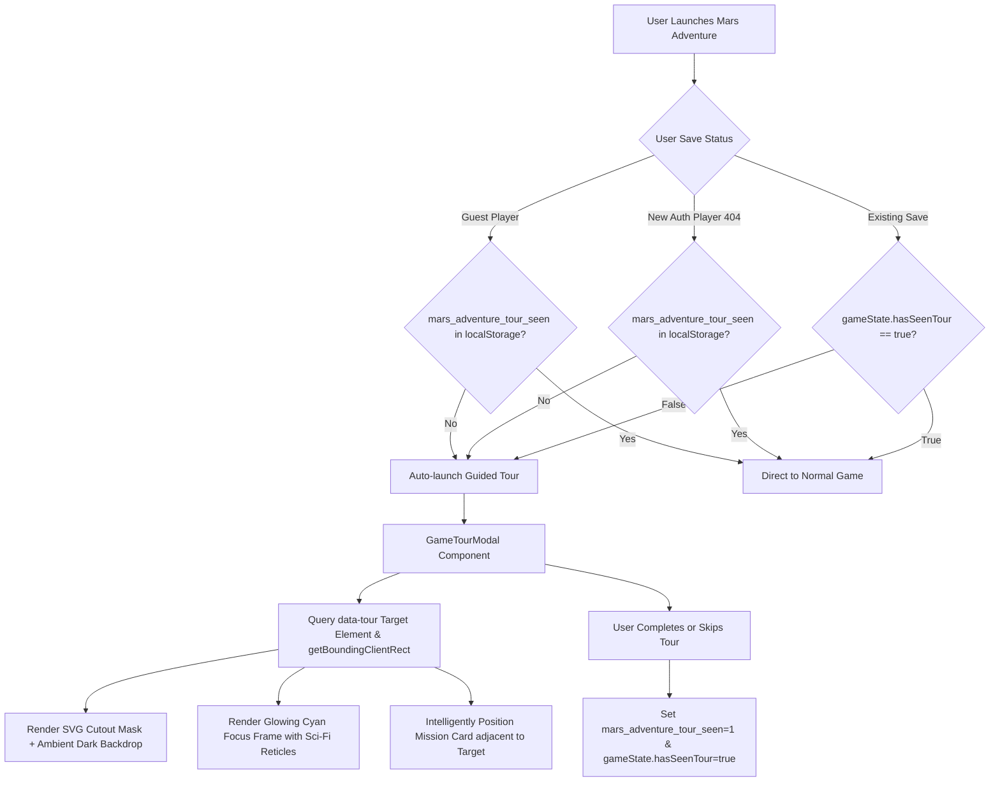

# Mars Adventure Tour Enhancement - Implementation Plan

## Executive Summary
This implementation plan outlines the architectural and code changes required to enhance the **Mars Adventure Tour** in the gamified experience:
1. **Default Onboarding for New Users**: Remove the dedicated "🧭 Tour" button from the main Toolbar and automatically trigger a guided onboarding tour whenever a new player launches the game for the first time (both for guest and authenticated players), with reliable persistence.
2. **Contextual Area Highlighting (Spotlight Effect)**: Enhance each tour slide to visually illuminate and highlight the exact UI/gameplay area being explained (Mission Quota, Power/Battery gauge, Command IDE, Tactical Surface) using a dynamic SVG spotlight mask, futuristic Mars HUD reticle frame, and smart card positioning.

---

## Architecture Overview



---

## Detailed Step-by-Step Implementation Plan

### Phase 1: New-User Detection & Default Tour Triggering

#### 1.1 Remove Dedicated Tour Button from Toolbar
- **File**: [`Toolbar.tsx`](file:///c:/Users/shubh/.vscode/gamified%20experience/frontend/components/UI/Toolbar.tsx)
- **Current State**: Line 249 renders `<button type="button" className="btn btn--ghost" onClick={onTour} title="Open Mission Tour">🧭 Tour</button>`.
- **Change**:
  - Remove the dedicated `🧭 Tour` button from the primary toolbar header to keep the interface uncluttered.
  - (Optional Replay Access): Add a subtle Help icon (`?`) or keyboard shortcut listener (`?` / `Shift + /`) in case users ever want to replay the briefing without having a prominent dedicated button.

#### 1.2 Fix Autosave Race Condition & State Inconsistency
- **File**: [`page.tsx`](file:///c:/Users/shubh/.vscode/gamified%20experience/frontend/app/rover-adventure/page.tsx)
- **Problem**: Lines 324 and 377 currently calculate `hasSeenTour: !showTour`. Because `showTour` initializes as `false`, the 800ms autosave immediately persists `hasSeenTour: true` on initial page mount before the user has actually seen or completed the tour!
- **Fix**:
  - Introduce an explicit state variable: `const [hasSeenTour, setHasSeenTour] = useState<boolean>(false);`.
  - Update `save.game_state.hasSeenTour` to read `hasSeenTour || Boolean(localStorage.getItem("mars_adventure_tour_seen"))`.
  - Only mark `hasSeenTour` as `true` inside `completeTour()` when the user finishes or clicks "Skip".

#### 1.3 Guarantee Default Tour Launch Across All User Flows
- **File**: [`page.tsx`](file:///c:/Users/shubh/.vscode/gamified%20experience/frontend/app/rover-adventure/page.tsx)
- Ensure all 3 entry conditions trigger the tour cleanly after initial component mounting (~600ms delay to allow canvas and code editor initialization):
  1. **New Guest User**: No guest save in `localStorage` and `!localStorage.getItem("mars_adventure_tour_seen")` $\rightarrow$ trigger `setShowTour(true)`.
  2. **New Authenticated User (404 missing save)**: Currently lines 256–296 do not launch the tour if no guest save exists. Add `if (!localStorage.getItem("mars_adventure_tour_seen")) { window.setTimeout(() => setShowTour(true), 600); }`.
  3. **Existing Save with Tour Pending**: If save exists and `gameState.hasSeenTour === false` and `!localStorage.getItem("mars_adventure_tour_seen")` $\rightarrow$ trigger `setShowTour(true)`.

---

### Phase 2: DOM Target Tagging for Tour Steps

Tag key visual sections with `data-tour` attributes so the spotlight component can query their bounding client rects dynamically:

| Step # | Slide Title | Visual Area | Target File | Element / Selector |
| :--- | :--- | :--- | :--- | :--- |
| **0** | **Welcome to Mars** | Full Martian terrain / Rover overview | [`page.tsx`](file:///c:/Users/shubh/.vscode/gamified%20experience/frontend/app/rover-adventure/page.tsx) | `data-tour="welcome"` (Centered / Full Canvas overview) |
| **1** | **Mission Objectives** | Mission quota, target minerals, stars | [`Toolbar.tsx`](file:///c:/Users/shubh/.vscode/gamified%20experience/frontend/components/UI/Toolbar.tsx) | `data-tour="mission-objectives"` on Quota & Round section |
| **2** | **Power and Charging** | Battery reserve meter & charging status | [`Toolbar.tsx`](file:///c:/Users/shubh/.vscode/gamified%20experience/frontend/components/UI/Toolbar.tsx) | `data-tour="power-charging"` on Power/Battery section |
| **3** | **Command IDE** | Code editor, programming language, Run button | [`page.tsx`](file:///c:/Users/shubh/.vscode/gamified%20experience/frontend/app/rover-adventure/page.tsx) | `data-tour="command-ide"` on IDE window container |
| **4** | **Tactical Surface** | Martian isometric grid, ore tiles, radiation zones | [`page.tsx`](file:///c:/Users/shubh/.vscode/gamified%20experience/frontend/app/rover-adventure/page.tsx) | `data-tour="tactical-surface"` on Canvas viewport container |

---

### Phase 3: Dynamic Spotlight & HUD Highlighting Component

#### 3.1 Step Metadata Structure
Enhance the steps definition in [`GameTourModal.tsx`](file:///c:/Users/shubh/.vscode/gamified%20experience/frontend/components/tour/GameTourModal.tsx):
```typescript
interface TourStep {
  title: string;
  badge: string;
  description: string;
  targetSelector: string | null;
  preferredPlacement: "center" | "bottom" | "right" | "top";
  padding?: number;
}

const TOUR_STEPS: TourStep[] = [
  {
    title: "Welcome to Mars",
    badge: "MISSION BRIEFING 1/5",
    description: "Welcome to Mars Adventure, Commander. Program an autonomous rover deployed in the Chryse Planitia basin and solve real robotic exploration challenges in Python, Java, or C++.",
    targetSelector: null, // Full view / Centered
    preferredPlacement: "center",
  },
  {
    title: "Mission Objectives",
    badge: "MISSION OBJECTIVES 2/5",
    description: "Each round asks you to secure vital minerals. Watch the quota in Mission Control, and finish efficiently with high remaining power to earn three-star ratings.",
    targetSelector: '[data-tour="mission-objectives"]',
    preferredPlacement: "bottom",
    padding: 8,
  },
  {
    title: "Power and Charging",
    badge: "LIFE SUPPORT 3/5",
    description: "Driving, scanning, and drilling consume battery. Later rounds unlock Solar Charging Stations; move within range and execute rover.charge() to restore power.",
    targetSelector: '[data-tour="power-charging"]',
    preferredPlacement: "bottom",
    padding: 8,
  },
  {
    title: "Command IDE",
    badge: "ROVER PROGRAMMING 4/5",
    description: "Write rover.drive(), rover.drill(), rover.scan(), and rover.charge() commands in the IDE. Press Run or Ctrl + Enter to send your program to Mission Control.",
    targetSelector: '[data-tour="command-ide"]',
    preferredPlacement: "right",
    padding: 6,
  },
  {
    title: "Tactical Surface",
    badge: "SURFACE OPERATIONS 5/5",
    description: "Explore the isometric terrain, avoid radiation zones, find buried ore, and place infrastructure. Your mission progress is continuously saved.",
    targetSelector: '[data-tour="tactical-surface"]',
    preferredPlacement: "center",
    padding: 0,
  },
];
```

#### 3.2 Visual Highlighting Architecture
1. **Dynamic Target Measurement (`getBoundingClientRect`)**:
   - Query `document.querySelector(step.targetSelector)`.
   - Calculate `x, y, width, height` plus optional padding.
   - Attach `window.addEventListener("resize", updateRect)` and `ResizeObserver` to keep the spotlight aligned across window resizes.
2. **SVG Spotlight Cutout Mask**:
   - Render an SVG element spanning `position: fixed; inset: 0; pointer-events: none; z-index: 90;`.
   - Use an SVG `<mask id="tour-mask">` with:
     - Base `<rect width="100%" height="100%" fill="white" />`
     - Active cutout `<rect x={rect.x} y={rect.y} width={rect.w} height={rect.h} rx="8" fill="black" />` with smooth CSS transition.
   - Render a dark backdrop `<rect width="100%" height="100%" fill="rgba(4, 7, 13, 0.78)" mask="url(#tour-mask)" />`.
3. **Mars HUD Reticle & Pulsing Cyan Frame**:
   - An overlay `<div>` matching the target rect with `position: fixed`.
   - Border: `2px solid var(--glow-cyan)`.
   - Outer glow: `box-shadow: 0 0 25px rgba(0, 212, 255, 0.45), inset 0 0 15px rgba(0, 212, 255, 0.15)`.
   - Corner reticle brackets (futuristic 4-corner accents: `┌ ┐ └ ┘`) using CSS pseudo-elements.
   - Smooth position interpolation: `transition: all 0.35s cubic-bezier(0.16, 1, 0.3, 1)`.
4. **Intelligent Modal Card Positioning**:
   - If `preferredPlacement === "bottom"`:
     - `top = targetRect.bottom + 16px`
     - `left = clamp(16px, targetRect.left + (targetRect.width / 2) - (cardWidth / 2), viewportWidth - cardWidth - 16px)`
   - If `preferredPlacement === "right"`:
     - `left = targetRect.right + 18px`
     - `top = clamp(16px, targetRect.top + (targetRect.height / 2) - (cardHeight / 2), viewportHeight - cardHeight - 16px)`
   - If `preferredPlacement === "center"` or no target:
     - Centered on screen (`top: 50%, left: 50%, transform: translate(-50%, -50%)`).
   - Connecting Pointer / Beacon indicating the direction of the target area.

---

### Phase 4: Styling & Keyframe Enhancements

Add support in [`globals.css`](file:///c:/Users/shubh/.vscode/gamified%20experience/frontend/app/globals.css) or component-scoped styles:
- `@keyframes tour-pulse`: subtle breathing cyan glow on the highlighted focus frame.
- Corner reticle brackets for tactical sci-fi HUD appearance.
- Smooth transition timing for the cutout mask and card translation.

---

## Verification & Testing Plan

### Automated Build Verification
1. Run TypeScript check:
   ```powershell
   cd frontend
   npm run build # or pnpm build
   ```
2. Verify zero TypeScript errors and successful Next.js static asset compilation.

### Manual Test Matrix
| Scenario | Steps to Execute | Expected Result |
| :--- | :--- | :--- |
| **New Guest User** | Open incognito window, navigate to `/rover-adventure` | Tour automatically starts after ~600ms without clicking any button. |
| **New Registered User** | Sign in with an account that has no prior Mars Adventure save | Tour launches automatically upon first load. |
| **Returning User** | Complete tour once, refresh page | Tour does not show again; game opens directly to workspace. |
| **Step 1 (Mission Quota)** | Observe step 1 | Spotlight smoothly illuminates Mission Quota & Objective bar; card sits below toolbar. |
| **Step 2 (Battery/Power)** | Click Next to step 2 | Spotlight glides to the Battery indicator; power gauge is highlighted. |
| **Step 3 (Command IDE)** | Click Next to step 3 | Spotlight expands around the Code Editor and Run button; card sits to its right. |
| **Step 4 (Tactical Surface)**| Click Next to step 4 | Spotlight highlights the Martian isometric terrain canvas. |
| **Keyboard & Dismissal** | Press Arrow keys, press Escape or click Skip | Navigation works seamlessly; `mars_adventure_tour_seen` is recorded and tour dismisses. |
| **Window Resize** | Resize browser while tour is active on Step 1 or 3 | Highlight frame and card smoothly recalculate their bounding rects. |

---

## Rollout Sequence
1. **Step 1**: Add `data-tour` tags to [`Toolbar.tsx`](file:///c:/Users/shubh/.vscode/gamified%20experience/frontend/components/UI/Toolbar.tsx) and [`page.tsx`](file:///c:/Users/shubh/.vscode/gamified%20experience/frontend/app/rover-adventure/page.tsx).
2. **Step 2**: Remove dedicated "🧭 Tour" button from [`Toolbar.tsx`](file:///c:/Users/shubh/.vscode/gamified%20experience/frontend/components/UI/Toolbar.tsx) (or retain subtle secondary shortcut).
3. **Step 3**: Fix the autosave race condition and new-user onboarding triggers in [`page.tsx`](file:///c:/Users/shubh/.vscode/gamified%20experience/frontend/app/rover-adventure/page.tsx).
4. **Step 4**: Refactor [`GameTourModal.tsx`](file:///c:/Users/shubh/.vscode/gamified%20experience/frontend/components/tour/GameTourModal.tsx) into a full spotlight HUD tour component with SVG cutout and intelligent positioning.
5. **Step 5**: Test in browser across screen sizes and save states.

